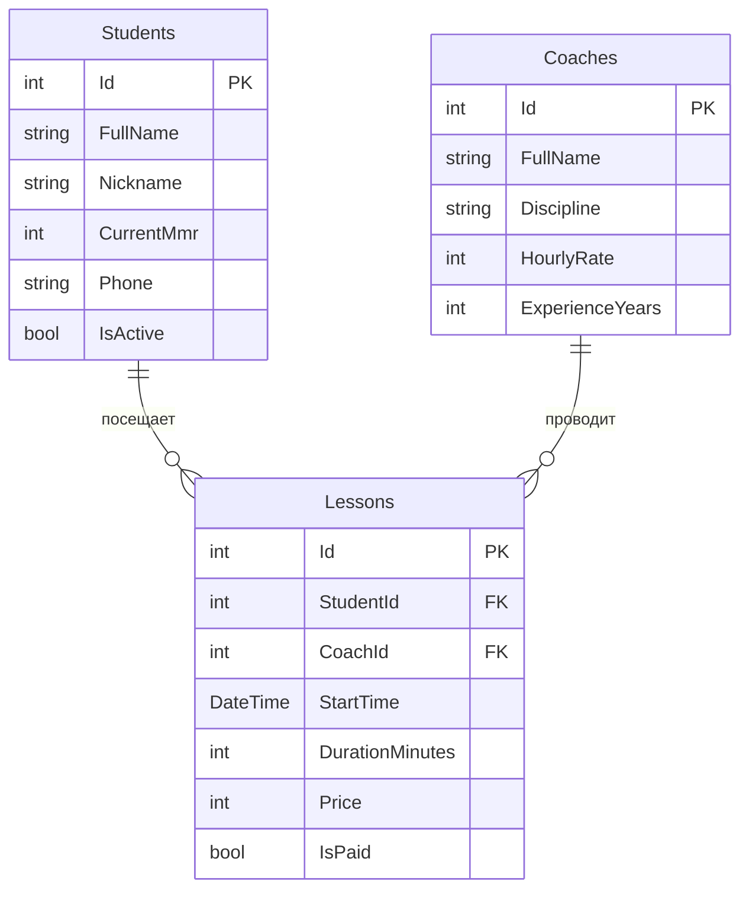

# CyberCore Manager

информационная система для учета учеников, тренеров и расписания тренировок в киберспортивной академии.

## Автор

Гарибян Левон, 9/3 РПО 24/2

## О проекте

тема: Школа или секция.  
название заведения: Киберспортивная академия «CyberCore».  

CyberCore - это современный тренировочный центр, где новички и полупрофессиональные игроки обучаются дисциплинам CS2, Dota 2 и Valorant под руководством действующих киберспортсменов. Приложением пользуются администраторы центра для ведения базы учеников, составления расписания занятий и контроля оплаты тренировок. Главная особенность - обязательный учет игрового рейтинга (MMR) и специализации по конкретным киберспортивным дисциплинам для точного подбора наставника.

## Схема базы

## Таблицы

### Students
в таблице хранится информация об учениках академии и их текущем игровом рейтинге.

| Поле | Тип | Обязательное | Описание |
| :--- | :--- | :--- | :--- |
| Id | int | Да | Уникальный идентификатор ученика (первичный ключ) |
| FullName | string | Да | Фамилия и имя ученика |
| Nickname | string | Да | Игровой никнейм в киберспортивной дисциплине |
| CurrentMmr | int | Нет | Текущий рейтинговый показатель игрока (MMR / ELO) |
| Phone | string | Да | Контактный номер телефона для связи |
| IsActive | bool | Да | Статус обучения (активный ученик или в архиве) |

### Coaches
в таблице содержатся данные о тренерском составе, их игровой специализации и стоимости часа работы.

| Поле | Тип | Обязательное | Описание |
| :--- | :--- | :--- | :--- |
| Id | int | Да | Уникальный идентификатор тренера (первичный ключ) |
| FullName | string | Да | Фамилия и имя тренера |
| Discipline | string | Да | Основная игровая дисциплина (CS2, Dota 2, Valorant) |
| HourlyRate | int | Да | Базовая ставка тренера за час занятия в рублях |
| ExperienceYears | int | Нет | Опыт тренерской или профессиональной игровой деятельности в годах |

### Lessons
связующая таблица хранит историю и расписание индивидуальных тренировок между учениками и тренерами.

| Поле | Тип | Обязательное | Описание |
| :--- | :--- | :--- | :--- |
| Id | int | Да | Уникальный идентификатор занятия (первичный ключ) |
| StudentId | int | Да | Внешний ключ, ссылающийся на ученика из таблицы Students |
| CoachId | int | Да | Внешний ключ, ссылающийся на тренера из таблицы Coaches |
| StartTime | DateTime | Да | Дата и время начала тренировки |
| DurationMinutes | int | Да | Продолжительность занятия в минутах |
| Price | int | Да | Итоговая стоимость занятия в рублях |
| IsPaid | bool | Да | Отметка об оплате тренировки |

## Связи

реализована связь многие ко многим между главными таблицами Students и Coaches через промежуточную таблицу `Lessons`:

* таблица Lessons ссылается на Students через обязательный внешний ключ StudentId.
* таблица Lessons ссылается на Coaches через обязательный внешний ключ CoachId.
